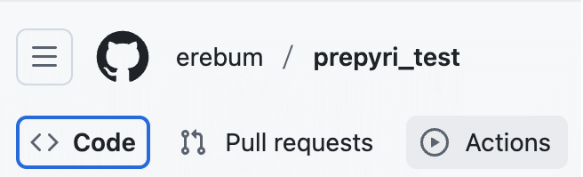

# Small Workflow to Post/Pre-Process OCR'd Texts for Papyri

(*This is specific to one project and its OCR model.*)

> Workflow: 
> Add files to `/in` -> .github/workflows triggers `script/prepyri.py` -> creates new file in `out` & appends log in `/log` & moves the input files to `/archive`.

## Features
- **Simple Markup Replacements**

| Character | Replacement |
| --- | ---|
| ⳨ | \*rho-cross\* |
| \+ | \*stauros\* |
| ·  | \*middot\* |
| ⳿ | \*word-sep-apostrophe\* |
| ⲓ̈ |  ⲓ(¨) |
| : | \*dipunct\* |

- **Handling Square Brackets** 
Auto-closes open Brackets and adds '.?'.  
*Abbreviations with hyphen and new line are not caught correctly.*

- **Abbreviations** 
Auto-surrounds with Brackets. 
*Does not catch cases of multiple '/'.*

- **Auto-move Hyphens** 
Moves Hyphens to next line. Introduces 'new line' when a hyphen ends the fragment.

- **Counting Dots** 
Counts Dots. 
*Whitespaces sometimes break this. Try to avoid whitespaces between dots.*

- **Line Numbering** 
Line numbering based of the markers included. 
Ie. it will look for a number and count up/down. When a text has line numbers 'below' zero a warning will be added to the log. 
*This feature sometimes breaks with comments between the lines.*

- **Logging** 
Upon each iteration of the workflow there will be logs (either appended to the log of the day or creating a new one) showing 'warnings' and the first couple lines of the `.txt` after the different steps of the script.

> [!IMPORTANT] 
> This will not replace going over the text again, but it might make it a bit faster to do so.

---

## Setup

(If you do not have a GitHub account create one first.)

Then 'fork' (*ie. create your own editable copy*) the repository by pressing `Fork`. 
Select any name and keep the settings.

By default GitHub will not activate the 'actions' feature. 
Thus head over to the `Actions` tab.

Here you simply enable the workflows.
Whenever you add new files to `./in` the workflow will run now. 

## OCR layouts and text boundaries

Uploads to `in/*.txt` still produce `out/out_*.txt`, a daily log, and an
unchanged copy of the input in `archive/`. The processing workflow is unchanged.
No packages beyond Python 3.10+ are required. The script can also be run from
any directory with `python /path/to/script/prepyri.py`.

Structure is reconstructed **before** the existing editorial substitutions,
hyphen movement and dot counting. The final fragment no longer needs a trailing
blank line. Each edition text is detected independently:

| Layout | Original line boundaries | OCR physical wraps |
| --- | --- | --- |
| `wysiwyg` | Physical lines; standalone counters are anchors | Preserved |
| `pipe` | Every `\|`, including inside a word; inline counters at line starts | Joined with spaces; wrap hyphens joined without a space |
| `numbered` | Standalone consecutive counters, with or without a final period | Joined until the next counter; wrap hyphens joined without a space |

`auto` uses pipes first, then consecutive separate counters, otherwise
`wysiwyg`. Original-line hyphens still use the existing movement rule. Empty
interior pipe segments are retained as numbered `[.?]` lines. A trailing pipe
only terminates the preceding line. Superscript footnote signs and inline notes
are retained. Standalone Latin paratext is preserved verbatim and not numbered;
`Above l. 1` and its following inscription are kept outside the body numbering.
Recto/verso labels do not reset numbering or start a new text.

Only edition headings start texts. `Element ...` OCR page banners and blank
lines do not. Explicit titles (`P.Mon.Epiph. 170`, `P.Ryl.Copt. 320`,
`Rylands Letters 320`) are recognized. Bare numbers of at least three digits
(with an optional period) need heading context: a document opening or adjacent
edition numbers, or numbers listed in corpus filenames such as
`PMonEpiph_113-114+123+127_2024-12-20.txt`, excluding established runs of line counters. Smaller or
ambiguous edition numbers can be specified explicitly in the configuration.
The filename supplies the collection name for PMonEpiph/PRylCopt files; other
collections keep bare numbers unless `edition` is configured.

The first explicit line anchor determines the starting number. Later conflicting
anchors generate warnings without resetting the sequence. Numbering continues
across pages and recto/verso. `start_line` overrides the inferred starting number.
Text before the first identifiable heading is retained and logged as unidentified.
Missing edition headings are never invented.

### Optional JSON overrides

Copy `prepyri.example.json` to **`prepyri.json` in the repository root** and edit
it as needed. It is loaded automatically by GitHub Actions. Alternatively use
`python script/prepyri.py --config path/to/config.json`.

- `files` keys are exact input basenames, including `.txt`.
- File `layout` defaults to `auto`. A `texts` entry overrides it for that edition
  number (string key); `auto` there restores automatic detection.
- `edition` changes the collection label for bare headings.
- `edition_numbers` is an optional exhaustive list of bare edition headings for
  that file, useful for small numbers or ambiguous OCR. Named titles still work.
- Per-text `start_line` must be positive; `_unidentified` addresses an opening
  passage without a heading.
- Invalid options fail before files are processed. As before, re-uploading the
  same filename replaces its output and archive. Config changes alone do not trigger processing; upload the input
  files together with, or after, the configuration.

### Tests and source limitations

Run `python -m unittest discover -s tests -v`. A separate read-only CI workflow
runs these tests on Python 3.10 and 3.12 for code/test changes and pull requests.
See `tests/fixtures/README.md` for the original regression inputs and their
limitations. Detection is a heuristic: OCR cannot always distinguish a bare
edition number from a counter, or repair interleaved columns. Review logged
conflicts and use explicit overrides for ambiguous headings. The parser preserves
source order; it does not silently reorder columns or restore absent headings.
